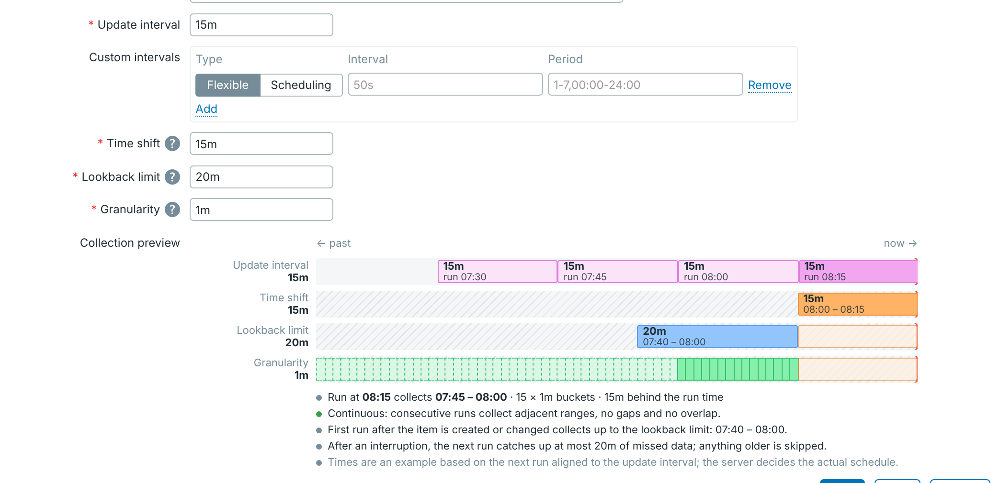
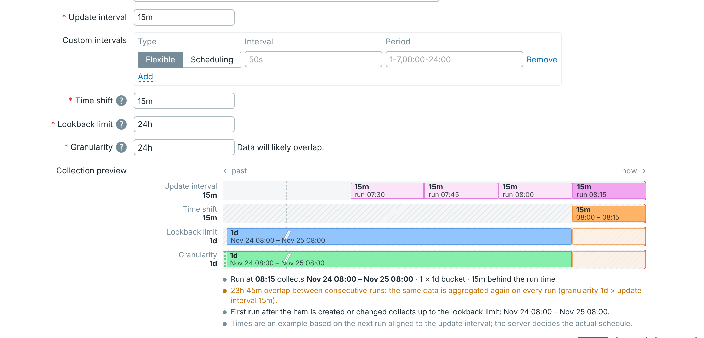
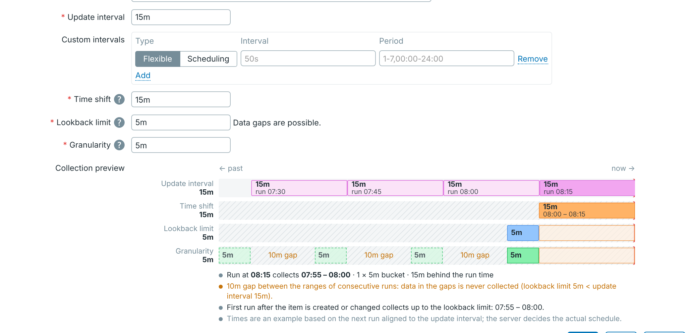

# Telemetry query preview for Zabbix

A Zabbix frontend module that shows **which time range a telemetry query item collects on every run**.
It adds a *Collection preview* to the item, item prototype and discovery rule forms, right below the
*Granularity* field, and updates it as you type.



## What it shows

One bar per setting on a common time axis ending at the next run (*now*), with clock times on the bars:

| Row | Meaning |
|---|---|
| **Update interval** | The last four runs and when they happen |
| **Time shift** | The newest part of the data that is not collected yet (`now − time shift … now`) |
| **Lookback limit** | The furthest a single run reaches back |
| **Granularity** | The buckets collected by the current run (solid) and the previous runs (dashed), with gaps marked |

Below the bars a short summary tells you:

- the exact range and number of buckets the current run collects;
- whether consecutive runs are **continuous**, leave **gaps** (lookback limit < update interval) or **overlap**
  (granularity > update interval) — and by how much;
- what the **first run** after creating or changing the item collects;
- how much missed data is **caught up** after an interruption;
- when **no data** is collected at all (lookback limit shorter than granularity).

Very long windows (e.g. 24h granularity with a 15m interval) are drawn on a compressed axis, marked with `//`.

| Hopping aggregation | Hopping aggregation with gaps |
|---|---|
|  |  |

### How the preview is calculated

The preview runs the same arithmetic as the Zabbix server
(`src/libs/zbxtelemetry/telemetry_query.c`, `tq_get_timestamp_filter_bounds_unshifted()`), simulated over a
series of runs so that the steady state is shown:

```
if granularity > now − lasttimestamp:   window = [now − granularity, now)                      (hopping)
else:  start = max(lasttimestamp, now − lookback_limit)
       window = [start, start + ⌊(now − start) / granularity⌋ × granularity)                   (whole buckets)
collected range = window − time shift;   next lasttimestamp = window end
```

Buckets are aligned to the start of the window, as in the generated ClickHouse query.

Limitations:

- The times are an example: *now* is the next run aligned to the update interval. The real schedule is decided
  by the server.
- Custom intervals are not simulated: with flexible intervals the preview uses the update interval (or the first
  flexible interval when the update interval is 0); scheduling intervals are not shown.
- Values with user macros cannot be previewed.

## Requirements

Zabbix frontend **8.0** with the *Telemetry query* item type (developed and tested with 8.0.1rc1, `release/8.0`).

## Installation

1. Copy the module to the frontend `modules` directory (the directory next to `zabbix.php`), e.g.

   ```bash
   cd /usr/share/zabbix/modules            # Docker images and most packages
   git clone https://github.com/<your-account>/zabbix-module-telemetry-query-preview.git telemetry-query-preview
   # or: unzip telemetry-query-preview-1.0.0.zip
   chmod -R o+rX telemetry-query-preview
   ```

   From sources the directory is `<zabbix sources>/ui/modules`. For Docker/Podman mount a host directory to
   `/usr/share/zabbix/modules` (e.g. `-v /opt/zabbix/modules:/usr/share/zabbix/modules:ro,Z`).

2. In Zabbix open **Administration → General → Modules**, click **Scan directory** and enable
   **Telemetry query preview**.

3. Open any item, item prototype or discovery rule, select the type **Telemetry query** – the preview appears
   under *Granularity*.

The module has no server-side code and no configuration; it only adds a stylesheet and a script to the frontend.
It changes nothing that is saved.

## Files

```
telemetry-query-preview/
├── manifest.json
├── assets/
│   ├── js/telemetry-preview.js     finds the form, simulates the runs, draws the preview
│   └── css/telemetry-preview.css   colours for the blue and dark themes
└── docs/                           screenshots
```

## License

Copyright (C) 2026 Telemetry query preview module contributors.

Licensed under the **GNU Affero General Public License v3.0** (`AGPL-3.0-only`), the same license as Zabbix.
See [LICENSE](LICENSE).

Zabbix is a registered trademark of Zabbix SIA.
